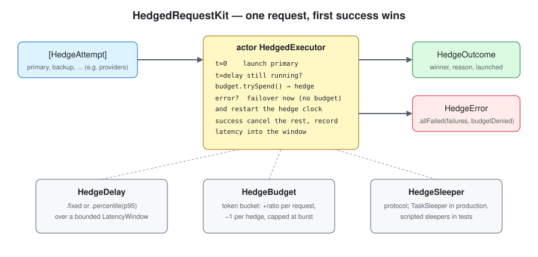
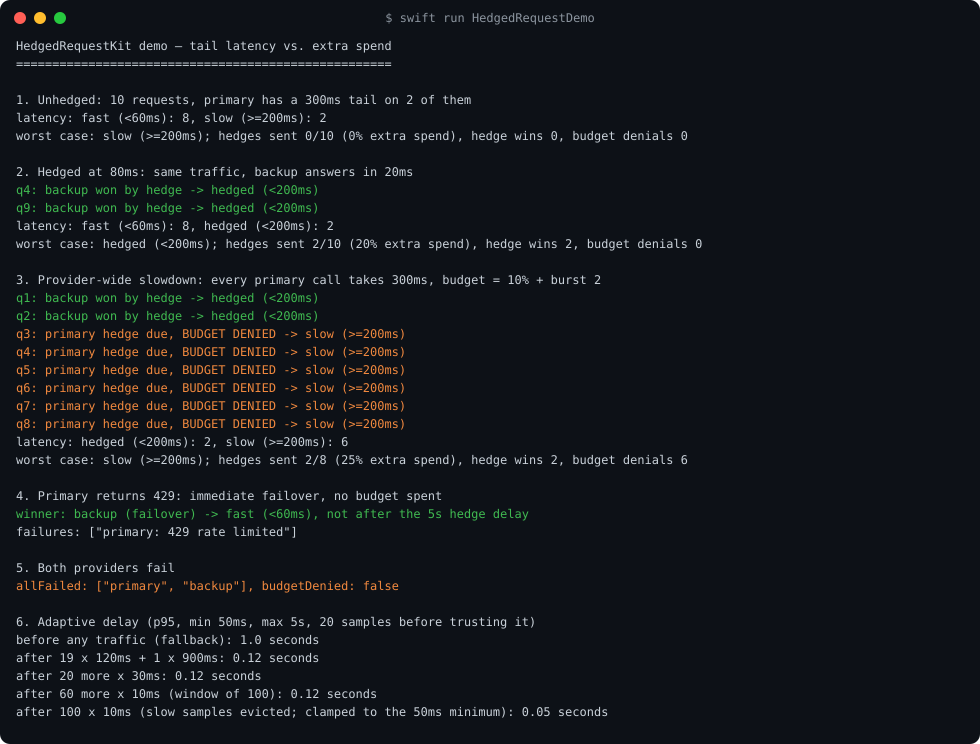
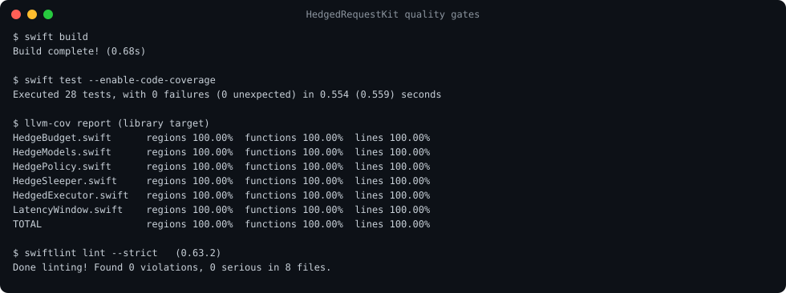

# HedgedRequestKit

Hedged requests for LLM calls in Swift. Send the request to a primary provider; if it hasn't
answered within a hedge delay, send it to a backup as well, keep whichever answers first and
cancel the other. A token-bucket budget caps how much extra spend that is allowed to cost.

Part of an ecosystem of Swift packages built around
[ProviderGatewayKit](https://github.com/rajatslakhina/foundation-model-provider-gateway).
Swift 6 strict concurrency, actor-based, no dependencies.



## The problem

Most LLM calls are fast. A few are very slow: a cold replica, a queue on the provider's side,
a noisy neighbour. Those few set your p99, and your p99 is what users remember. In a voice
agent or an autocomplete box, one 4-second pause makes the product feel broken.

The tools this ecosystem already has don't help with that. ProviderGatewayKit's circuit
breaker and RetryPolicyKit both act *after* a failure. A slow call hasn't failed. It is still
running, and waiting for it to time out before retrying makes the tail worse, not better.

Hedging does what those can't. If the primary is still running when most requests would have
finished, start a second copy somewhere else and take the first answer. Slow calls are
usually rare and independent, so it is unlikely both copies are slow on the same request.

The catch is cost. Every hedge is a second paid request. If a provider slows down for
*everyone*, naive hedging doubles your bill at exactly the moment it stops helping, because
now both copies are slow. That's why the budget is part of the package's core API rather than
an afterthought.

## How it works

`HedgedExecutor` is an actor. For each request it:

1. Deposits `ratio` tokens into the `HedgeBudget` (capped at `burst`).
2. Resolves the hedge delay: `.fixed(…)`, or `.percentile(…)` of recent winning latencies in a
   bounded `LatencyWindow` (the default `.p95` falls back to 1s until it has 20 samples and is
   clamped to 50ms…5s).
3. Launches the primary and starts a timer.
4. Reacts to whichever happens first:
   - **Success**: cancel everything else, record the latency, return a `HedgeOutcome`.
   - **Timer fires while an attempt is still running**: spend one budget token and launch the
     next attempt as a *hedge*. If the budget is empty, note `budgetDenied` and keep waiting.
   - **An attempt fails**: launch the next attempt at once as a *failover* (spends no budget,
     since the failed call no longer costs anything) and restart the hedge clock for it.
5. If nothing is left running and nothing more can start, throw
   `HedgeError.allFailed(failures, budgetDenied:)`.

Each `HedgeOutcome` records the winner, *why* it was launched (`.primary` / `.hedge` /
`.failover`), every launch in order, the failures before the win, the latency and the delay
used. `HedgeStats` counts requests, hedges, hedge wins, failovers, budget denials and
exhausted requests, plus a `hedgeRate` (the extra spend per request).

Timing goes through a `HedgeSleeper` protocol. Production uses `TaskSleeper`; the tests inject
sleepers that fire immediately, never, or only once, so every branch is tested
deterministically instead of relying on races.

## Usage

```swift
import HedgedRequestKit

let executor = HedgedExecutor(policy: HedgePolicy(
    delay: .p95,                                   // hedge at the observed p95
    maxAttempts: 2,                                // primary + one backup
    budget: HedgeBudget(ratio: 0.1, burst: 10),    // at most ~10% extra requests
    failoverOnError: true
))

let outcome = try await executor.execute([
    HedgeAttempt("openrouter/standard") { try await standard.complete(prompt) },
    HedgeAttempt("openrouter/priority") { try await priority.complete(prompt) }
])

print(outcome.value, outcome.winner, outcome.winnerReason)   // e.g. "…", "openrouter/priority", .hedge
let stats = await executor.snapshot()
print("extra spend: \(Int(stats.hedgeRate * 100))%")
```

With ProviderGatewayKit, wrap each provider's stream in an attempt. For example, two
`LLMSession`s over routers pinned to different providers:

```swift
let outcome = try await executor.execute([
    HedgeAttempt("cloud")       { try await LLMSession(router: cloudRouter).send(prompt).text },
    HedgeAttempt("self-hosted") { try await LLMSession(router: selfHostedRouter).send(prompt).text }
])
```

Attempts **must be cancellation-cooperative**. URLSession and `AsyncThrowingStream` consumers
are. The executor cancels losers, but because it uses a structured task group it cannot return
until they actually stop.

## Install

```swift
.package(url: "https://github.com/rajatslakhina/hedged-request-kit.git", from: "1.0.0")
```

then add `"HedgedRequestKit"` to your target's dependencies.

## Demo

```
swift run HedgedRequestDemo
```

Scripted providers with real sleeps: 20ms for a normal call, 300ms for a tail call, hedging at
80ms. Latencies are reported in buckets with wide gaps so the output is the same on every run
(it was byte-identical across 5 runs). The six scenarios:

1. **Unhedged**: 2 of 10 requests land in the 300ms tail.
2. **Hedged**: the same traffic. Both tail requests are won by the backup in under 200ms, for
   20% extra requests.
3. **Provider-wide slowdown**: every primary call is slow. The 10% budget with a burst of 2
   pays for 2 hedges and then refuses 6, so spend is capped at 25% instead of 100%.
4. **429 from the primary**: immediate failover, not after the 5s hedge delay, with no budget
   spent.
5. **Both fail**: `allFailed`.
6. **Adaptive delay**: p95 learning, including why fast samples don't lower it until the slow
   ones leave the window.



Full text: [`Screenshots/demo-output.txt`](Screenshots/demo-output.txt).

## Quality



- `swift build`: 0 warnings, 0 errors (Swift 6.2.4, strict concurrency).
- `swift test --enable-code-coverage`: 28 tests, 0 failures. Clean on 5 repeated runs.
- `llvm-cov report`: 100.00% lines, regions and functions on every library file.
- `swiftlint lint --strict` (0.63.2, run for real): 0 violations.

## Limits

- **The adaptive delay learns from winners only.** A request won by a hedge records the
  hedged latency, not how long the primary would have taken, so p95 is biased low while
  hedging is active. Feed unhedged observations in with `observe(latency:)` if you have them.
- **Hedging only helps when slowness is independent.** If both attempts share a bottleneck
  (same provider, same region, same rate limit), the hedge is just a second slow request.
  The budget bounds that cost; it doesn't detect it.
- **Hedging non-idempotent work duplicates it.** Two copies of a tool call with side effects
  run twice. Hedge completions, not actions (see IdempotencyKit for the latter).
- **Losers are billed.** Cancelling a streaming request stops the stream, but most providers
  still bill tokens generated before the cancel arrives.
- Without `failoverOnError`, a primary that fails early waits out the rest of the hedge delay
  before the next attempt starts.

## License

MIT
